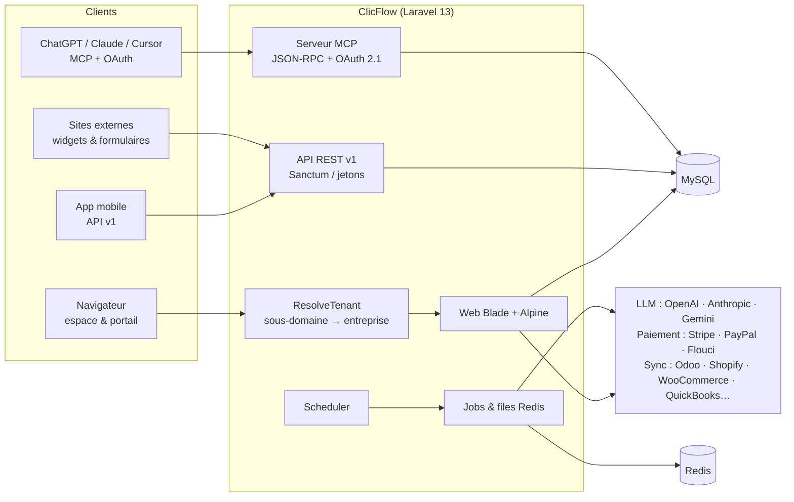

<p align="center">
  
</p>

<h1 align="center">ClicFlow</h1>
<p align="center"><em>The AI workspace for agencies and service teams — CRM, projects, billing and automation in one place.</em></p>

ClicFlow (nom de code interne **FlowDesk**) est un **SaaS multi-entreprise** (multi-tenant) développé avec Laravel. Chaque entreprise cliente dispose de son propre espace sur un sous-domaine (`<entreprise>.votre-domaine`), avec ses utilisateurs, ses données isolées, son image de marque, ses modules activés selon son abonnement, un portail client et un assistant IA (chat + voix « Nova »).

---

## Sommaire

1. [Vue d'ensemble](#1-vue-densemble)
2. [Architecture](#2-architecture)
3. [Modules fonctionnels](#3-modules-fonctionnels)
   - [CRM : clients, prospects, relances](#31-crm--clients-prospects-relances)
   - [Ventes & facturation](#32-ventes--facturation)
   - [Projets, tâches & études](#33-projets-tâches--études)
   - [Portail client](#34-portail-client)
   - [Coffre-fort (fichiers)](#35-coffre-fort-fichiers)
   - [Intelligence artificielle : chat, Nova, rédaction](#36-intelligence-artificielle--chat-nova-rédaction)
   - [Serveur MCP (ChatGPT, Claude, Cursor…)](#37-serveur-mcp-chatgpt-claude-cursor)
   - [Marketing & e-mailing](#38-marketing--e-mailing)
   - [Agenda, réservations & réunions](#39-agenda-réservations--réunions)
   - [Commerce, stock & caisse (POS)](#310-commerce-stock--caisse-pos)
   - [RH & paie](#311-rh--paie)
   - [Immobilier](#312-immobilier)
   - [Apporteurs d'affaires](#313-apporteurs-daffaires)
   - [Contrats & négociations](#314-contrats--négociations)
   - [Formulaires, widgets & support](#315-formulaires-widgets--support)
   - [Analyses & rapports](#316-analyses--rapports)
   - [Marketplace de modules](#317-marketplace-de-modules)
   - [Intégrations tierces](#318-intégrations-tierces)
   - [Paiements & abonnements](#319-paiements--abonnements)
   - [Administration plateforme](#320-administration-plateforme)
4. [Rôles & permissions](#4-rôles--permissions)
5. [Plans & fonctionnalités](#5-plans--fonctionnalités)
6. [API REST](#6-api-rest)
7. [Stack technique](#7-stack-technique)
8. [Installation locale](#8-installation-locale)
9. [Variables d'environnement](#9-variables-denvironnement)
10. [Files d'attente & tâches planifiées](#10-files-dattente--tâches-planifiées)
11. [Build front-end](#11-build-front-end)
12. [Déploiement](#12-déploiement)
13. [Tests](#13-tests)
14. [Documentation complémentaire](#14-documentation-complémentaire)
15. [Licence](#15-licence)

---

## 1. Vue d'ensemble

| Élément | Description |
|---|---|
| **Multi-tenant** | Une base de données, isolation par `company_id` (scope global `TenantScope`). Résolution de l'espace par sous-domaine (`FLOWDESK_TENANT_BASE_DOMAIN`) ; domaines centraux pour l'admin et l'inscription (`FLOWDESK_CENTRAL_DOMAINS`). |
| **Espaces** | Inscription d'une entreprise (e-mail ou Google / GitHub / LinkedIn), période d'essai, choix d'un plan, sous-domaine dédié. |
| **Utilisateurs** | Administrateurs d'espace, membres d'équipe, apporteurs d'affaires, clients (portail). Double authentification (TOTP), liste blanche d'IP par espace. |
| **Langues** | Français, anglais, espagnol, arabe (RTL), hindi, indonésien. Détection automatique possible par IP. |
| **Devises & TVA** | Multi-devise avec conversion, TVA par pays, par produit et par ligne, timbre fiscal. |
| **Personnalisation** | Logo, couleurs, thèmes et préréglages d'interface, menu de navigation et tableau de bord configurables, domaine d'e-mail (SMTP par espace). |

## 2. Architecture



Arborescence principale : `app/Http/Controllers` (web, `Api/`, `Portal/`, `Admin/`, `Settings/`, `Mcp/`…), `app/Services` (logique métier), `app/Models`, `resources/views` (Blade), `resources/js` (Alpine, Vite), `database/migrations`, `lang/`, `tests/`.

## 3. Modules fonctionnels

### 3.1 CRM : clients, prospects, relances
- **Clients** : fiche complète (société, contact principal, catégorie, statut, adresse avec code postal, devise, langue), création rapide depuis les devis/factures, comptes portail, demandes de création de compte.
- **Prospects** : pipeline, conversion en client, campagnes et relances (`ClientFollowUp`, `ClientCampaign`).
- **Import de données** : CSV/Excel/collage pour clients, prospects, produits, factures, devis, projets… avec mappage des colonnes (`DataImportService`), y compris exports Perfex.
- **Messagerie & notifications** internes, journal d'audit.

### 3.2 Ventes & facturation
- **Produits & services** : catalogue avec variantes, unités, stock, deux taux de taxe par produit, suppression multiple, import CSV, rédaction IA des fiches.
- **Devis (propositions)** : éditeur simplifié partagé avec les factures, lignes avec **titre + description**, TVA par ligne, remise, acceptation/signature par le client, conversion en facture, envoi par e-mail, PDF.
- **Factures** : numérotation, brouillon/envoyée/payée, factures **récurrentes**, **relances** automatiques, paiement en ligne (Stripe, PayPal, Flouci), reçus, thèmes PDF (Dompdf, support arabe), aperçu avant enregistrement.
- **Acomptes / échéances de projet** (`ProjectInstallment`) avec reçus de dépôt PDF.
- **Commandes & livraisons** (module Commerce).
- **IA** : génération de lignes de devis/facture, scan de documents (extraction de lignes).

### 3.3 Projets, tâches & études
- Projets liés aux clients, tâches avec statuts, commentaires (notifications e-mail), **diagramme de Gantt**, fichiers de projet avec miniatures et quotas.
- **Études de projet** : rédaction assistée par IA, export PDF, transformation en devis.
- Import de projets depuis PDF/tableur, synchronisation **Notion** et **Trello**.

### 3.4 Portail client
Espace client (même sous-domaine) : tableau de bord, devis (acceptation), factures et paiement en ligne, projets, contrats, rendez-vous et réservations, demandes de devis, campagnes, coffre-fort partagé, assistant IA « conseiller ». Les sections visibles sont réglables par l'entreprise (`PortalVisibilityService`).

### 3.5 Coffre-fort (fichiers)
Stockage de fichiers par espace (dossiers, projets, clients), visibilité équipe/client/apporteur, **corbeille** avec purge automatique, **liens de partage** publics à durée limitée.

### 3.6 Intelligence artificielle : chat, Nova, rédaction
- **Chat IA latéral** (panneau droit pleine hauteur, historique persistant) : questions sur l'espace, création guidée qui **ouvre le bon formulaire et le remplit en direct** (devis, factures, clients, produits, projets, tâches) — rien n'est enregistré sans validation.
- **Voix dans le chat** : dictée, réponses parlées, mode conversation (indépendant de Nova).
- **Nova** : assistant vocal de la barre supérieure (navigation, briefings, création de documents/événements, recherche web, mode « live »), activable par entreprise et par l'admin plateforme.
- **Rédaction** : contrats, e-mails, campagnes, fiches produits, rapports, conseils de croissance.
- Fournisseurs : OpenAI, Anthropic Claude, Google Gemini (routage plateforme) ; synthèse vocale OpenAI, Gemini, Cartesia, Edge. Consommation suivie en **crédits IA** par espace.

### 3.7 Serveur MCP (ChatGPT, Claude, Cursor…)
- Point d'accès `https://<entreprise>.<domaine>/mcp` (Streamable HTTP, JSON-RPC 2.0, protocole 2025-06-18) avec ~23 outils : lister/créer clients, prospects, projets, tâches, devis et factures (toujours en brouillon), tickets, rendez-vous, produits, fichiers du coffre-fort, statistiques de campagnes.
- **Authentification** : clés `cfm_…` (Lecture / Écriture) **ou OAuth 2.1** pour ChatGPT et Claude — découverte (RFC 9728 / 8414), enregistrement dynamique de client, PKCE S256, page de consentement, jetons à rotation, révocation, portées `mcp:read` / `mcp:write`.
- Nom affiché « *Entreprise* - ClicFlow », journal d'audit, limite de débit. MCP plateforme séparé pour l'administration (`/admin/mcp`).
- **Guide d'intégration intégré** : *Paramètres → MCP* (ChatGPT, Claude, Claude Code, Cursor, VS Code, dépannage).

### 3.8 Marketing & e-mailing
Audiences, campagnes, séquences automatisées, modèles (avec IA), suivi d'ouverture (pixel), balises de fusion ; **Marketing hub** (SEO, intégrations Google Analytics / Tag Manager / Mailchimp, traceur marketing), démo publique Nova.

### 3.9 Agenda, réservations & réunions
Calendrier d'équipe, événements, réservation en ligne par les clients, synchronisation **Google Calendar**, liens de réunion (Zoom, Google Meet), résumés de réunion et transcriptions Meet, rappels push (FCM).

### 3.10 Commerce, stock & caisse (POS)
Produits, commandes, livraisons, gestion de stock, **caisse POS**, synchronisation **Shopify** et **WooCommerce** (webhooks).

### 3.11 RH & paie
Employés, départements, congés, avances, **paie** et bulletins PDF, espace self-service employé.

### 3.12 Immobilier
Demandes, offres et contrats immobiliers.

### 3.13 Apporteurs d'affaires
Recrutement de partenaires, partenariats, projets et devis apportés, **commissions**, demandes et validation de reversements, espace dédié.

### 3.14 Contrats & négociations
Modèles de contrats, fusion de données, génération IA, PDF, références ; suivi des négociations.

### 3.15 Formulaires, widgets & support
Constructeur de formulaires (champs, soumissions, conversion en prospect/client), widgets intégrables sur sites externes, demandes entrantes, **tickets de support**.

### 3.16 Analyses & rapports
Tableau de bord configurable (widgets, graphiques), analyses, rapports avec synthèse IA, indicateurs d'usage.

### 3.17 Marketplace de modules
Modules verticaux installables en `.zip` (manifeste, vues, migrations `module_*`, intégration CRM et Nova), analyse de sécurité, panier et paiement des modules, traductions. Voir [`MODULE.md`](MODULE.md).

### 3.18 Intégrations tierces
Odoo (JSON-RPC), QuickBooks, Perfex CRM, Shopify, WooCommerce, Notion, Trello, Google Calendar, Zoom, Calendly, Mailchimp, SendGrid / SMTP par espace, Twilio (SMS de test), Firebase Cloud Messaging.

### 3.19 Paiements & abonnements
Plans et tarifs, essai gratuit, abonnement **Stripe** (checkout, portail client, webhooks), commandes d'abonnement, passerelles de paiement des factures configurables par espace (Stripe, PayPal, Flouci).

### 3.20 Administration plateforme
Console `/admin` : entreprises, utilisateurs, plans, abonnements, paiements, commandes marketplace, modules, bibliothèque de thèmes et de modèles PDF, modèles e-mailing, apparence, paramètres plateforme (clés API stockées **chiffrées**), documentation développeur, rapports, MCP admin, interrupteur global Nova.

## 4. Rôles & permissions

Gestion par `spatie/laravel-permission` (`TeamPermissionCatalog`) :

| Rôle | Accès |
|---|---|
| `company_admin` | Tout l'espace : paramètres, équipe, facturation, intégrations, MCP. |
| `team_member` | Selon les permissions attribuées par l'administrateur. |
| `business_provider` | Espace apporteur d'affaires. |
| `client` | Portail client uniquement. |
| Admin plateforme | Garde séparée (`/admin`). |

## 5. Plans & fonctionnalités

Les routes sont protégées par `plan.feature:<clé>` (`ModuleEntitlementService`, `PlanLimitService`) :
`ai_credits`, `analytics`, `calendar`, `ecommerce`, `email_marketing`, `forms`, `hr`, `marketing_hub`, `modules`, `odoo`, `pos`, `projects`, `providers`, `real_estate`, `reports`, `shopify`, `widgets`, `woocommerce`, `workspace_ai_agent`.

## 6. API REST

Préfixe `/api/v1` (limite 60 req/min) :

| Préfixe | Usage |
|---|---|
| `v1/company` | App mobile équipe : authentification, tableau de bord, clients, devis, factures (PDF, envoi), projets, agenda, Nova (chat/voix), notifications, jetons push. |
| `v1/client` | App/portail client : authentification, devis, factures, projets, messages. |
| `v1/workspace` | API d'intégration par jeton d'espace : clients, factures, projets, import. Documentation dans *Paramètres → API*. |
| `v1/embed` | Formulaires et traceur intégrables. |

Webhooks entrants : Stripe, Flouci, Shopify, WooCommerce.

## 7. Stack technique

- **Back-end** : PHP 8.3+ (8.4 recommandé), Laravel 13, Sanctum, Socialite, spatie/permission, spatie/backup, Dompdf, Google API Client, Stripe, Twilio, Sentry, Predis.
- **Front-end** : Blade, Alpine.js, Tailwind CSS, Vite, Chart.js, SortableJS, GrapesJS, Three.js, Font Awesome, icônes animées maison (`x-cf-icon`).
- **Données** : MySQL / MariaDB, Redis (cache, files d'attente).
- **Tests** : Pest.

## 8. Installation locale

Prérequis : PHP 8.3+ (extensions `mbstring`, `intl`, `gd`, `zip`, `pdo_mysql`, `redis` ou Predis), Composer, Node 20+, MySQL, Redis.

```bash
git clone https://github.com/dridihatem/clicflow-saas.git
cd clicflow-saas
composer install
npm install
cp .env.example .env
php artisan key:generate
# renseigner DB_*, REDIS_*, FLOWDESK_TENANT_BASE_DOMAIN, APP_URL…
php artisan migrate --seed
php artisan storage:link
npm run build        # ou: npm run dev
php artisan serve
```

**MAMP (macOS)** : placer le projet dans `htdocs`, utiliser le MySQL de MAMP dans `.env`, faire pointer le virtual host sur `public/`. Pour tester les sous-domaines, ajouter des entrées dans `/etc/hosts` (ex. `demo.clicflow.test`) et définir `FLOWDESK_TENANT_BASE_DOMAIN=clicflow.test`.

## 9. Variables d'environnement

Voir `.env.example`. Principales clés (noms uniquement) :

| Groupe | Clés |
|---|---|
| Application | `APP_NAME`, `APP_ENV`, `APP_KEY`, `APP_DEBUG`, `APP_URL`, `APP_LOCALE`, `APP_FALLBACK_LOCALE` |
| Marque & tenancy | `FLOWDESK_BRAND_NAME`, `FLOWDESK_BRAND_TAGLINE`, `FLOWDESK_CENTRAL_DOMAINS`, `FLOWDESK_TENANT_BASE_DOMAIN`, `FLOWDESK_DEFAULT_LOCALE`, `FLOWDESK_DEFAULT_CURRENCY`, `FLOWDESK_IP_LOCALE_LOOKUP`, `FLOWDESK_BLOCK_MOBILE_WORKSPACE` |
| Essai & admin | `FLOWDESK_TRIAL_DAYS`, `FLOWDESK_TRIAL_PLAN_SLUG`, `FLOWDESK_PLATFORM_ADMIN_EMAIL`, `FLOWDESK_PLATFORM_ADMIN_PASSWORD` |
| IA | `FLOWDESK_AI_ASSISTANT_NAME`, `FLOWDESK_AI_CREDIT_PRICE_MINOR`, `FLOWDESK_AI_FAST_OPENAI`, `FLOWDESK_AI_FAST_ANTHROPIC`, `FLOWDESK_AI_FAST_GEMINI`, `FLOWDESK_NOVA_VOICE_TTS`, `FLOWDESK_NOVA_NAV_CHAT` |
| Base & cache | `DB_*`, `REDIS_*`, `CACHE_STORE`, `QUEUE_CONNECTION`, `SESSION_*` |
| E-mail | `MAIL_*`, `RESEND_API_KEY`, `POSTMARK_API_KEY` |
| OAuth social | `GOOGLE_*`, `GITHUB_*`, `LINKEDIN_*`, `GOOGLE_CALENDAR_REDIRECT_URI` |
| Paiement | `STRIPE_SECRET`, `STRIPE_WEBHOOK_SECRET` |
| Divers | `FCM_PROJECT_ID`, `FCM_CREDENTIALS`, `SENTRY_LARAVEL_DSN`, `BACKUP_DISK`, `AWS_*` |

Les clés des fournisseurs IA, des passerelles de paiement et des intégrations se configurent dans l'admin plateforme ou les paramètres de l'espace (stockées chiffrées en base). **Ne jamais committer `.env`.**

## 10. Files d'attente & tâches planifiées

```bash
php artisan queue:work --tries=3      # en production via Supervisor
```

Cron (une entrée) :
```cron
* * * * * cd /chemin/vers/app && php artisan schedule:run >> /dev/null 2>&1
```

| Tâche | Fréquence |
|---|---|
| `invoices:process-recurring` | tous les jours 08:30 |
| `invoices:send-reminders` | tous les jours 09:00 |
| `clicflow:send-push-reminders` | toutes les 15 min |
| `backup:run` | tous les jours 02:00 |
| `vault:purge-trash` | tous les jours 03:15 |

## 11. Build front-end

```bash
npm run build   # Vite + vérification du manifeste (public/build, non versionné)
npm run dev     # serveur de développement
```

## 12. Déploiement

Procédure type (sans cache de config/routes) :

1. Sauvegarder fichiers et base (`spatie/laravel-backup` ou dump).
2. Mettre à jour le code, `composer install --no-dev -o`, `npm ci && npm run build`.
3. `php artisan migrate --force` (migrations additives).
4. `php artisan view:clear && php artisan cache:clear && php artisan config:clear && php artisan route:clear`.
5. Droits au serveur web sur `storage/` et `bootstrap/cache/`, recharger PHP-FPM.
6. `php artisan queue:restart` (redémarre les workers Supervisor).
7. Vérifier les pages clés et `storage/logs/laravel.log`.

Serveur web : racine sur `public/`, wildcard DNS + certificat pour `*.votre-domaine` (sous-domaines des espaces).

## 13. Tests

```bash
php artisan test            # ou: php artisan test --parallel
php artisan test tests/Feature/McpOAuthTest.php
```

Suite Pest (Feature + Unit) : facturation, TVA par ligne, MCP + OAuth, portail, imports, IA (sans appel réel aux fournisseurs), modules…

## 14. Documentation complémentaire

- [`MODULE.md`](MODULE.md) — créer un module installable.
- [`NOVA.md`](NOVA.md) — assistant vocal Nova.
- [`modules-international.md`](modules-international.md) — catalogue de modules métier.
- Guide MCP / IA : dans l'application, *Paramètres → MCP*.
- Documentation API : *Paramètres → API* et documentation développeur de l'admin.

## 15. Licence

© ClicFlow — Tous droits réservés. Logiciel propriétaire : aucune licence d'utilisation, de copie ou de redistribution n'est accordée sans autorisation écrite de l'auteur.
